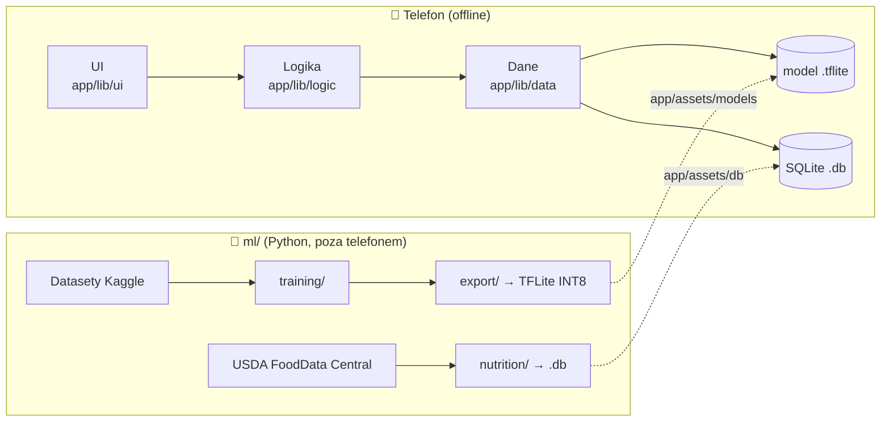

# 🥦 Freshness

[](https://github.com/PJATK404/Freshness_/actions/workflows/ci.yml)

Aplikacja mobilna, która **na podstawie zdjęcia rozpoznaje warzywo lub owoc, ocenia jego świeżość przy pomocy AI i pokazuje jego wartości odżywcze** (makro- i mikroelementy oraz witaminy na 100 g). Działa **w 100% offline**: bez serwera, bez kont, a zdjęcia nie opuszczają telefonu.

Projekt zespołowy PJATK. Opiekun: dr hab. inż. Marta Łabuda.

| Zespół | Rola |
|---|---|
| Kamil Różański | Kierownik projektu |
| Kacper Bednarek | |
| Paweł Centkowski | |
| Piotr Kinowski | |

## Po co

- **Mniej zatruć pokarmowych**, bo wczesne oznaki psucia (przebarwienia, plamy, pleśń) łatwo przeoczyć.
- **Szybki dostęp do wartości odżywczych** zamiast szukania ich w tabelach i serwisach.
- Jedna **darmowa** aplikacja, która łączy rozpoznanie produktu, ocenę świeżości i dane odżywcze, i działa offline.

## Funkcje

- Zdjęcie z aparatu albo wybór z galerii.
- Rozpoznanie rodzaju produktu i ocena świeżości wraz z pewnością modelu:

  | Pewność „świeży” | Komunikat |
  |---|---|
  | ≥ 90% | ✅ Świeży |
  | 75–89% | 🟡 Raczej świeży |
  | < 75% | ❌ Raczej zepsuty |

- Wartości odżywcze na 100 g dla rozpoznanego produktu.
- Ręczna korekta wyniku, gdy model się pomyli.
- Wyszukiwanie produktu bez skanowania.
- Lokalna historia skanów.

Poza zakresem: produkty egzotyczne i rzadkie, zepsucie niewidoczne na powierzchni, konta użytkowników.

## Miary sukcesu

- Poprawne rozpoznanie produktu w **≥ 80%** przypadków.
- Poprawna ocena świeżości w **≥ 75%** przypadków.
- Wynik skanu z danymi odżywczymi w czasie **< 10 s**.
- Responsywna aplikacja, która się nie zawiesza (także na budżetowych telefonach z 2–3 GB RAM).

## Tech stack

| Obszar | Technologia |
|---|---|
| Aplikacja | **Flutter (Dart)**: jedna baza kodu na Androida i iOS |
| Inferencja na telefonie | `tflite_flutter` + model **TensorFlow Lite INT8** (~5–6 MB) |
| Lokalna baza | **SQLite** (`sqflite`): wartości odżywcze + historia skanów |
| Model | **MobileNetV3-Large** (ImageNet) + transfer learning, 1 sieć, 2 głowice: produkt + świeżość |
| Trening | **Python 3.12**, **PyTorch** + torchvision, GPU z Google Colab / Kaggle |
| Dane treningowe | Kaggle: *Fresh and Stale Images of Fruits and Vegetables*, *Fruits fresh and rotten for classification* |
| Wartości odżywcze | **USDA FoodData Central** (public domain) → skrypt Python → plik `.db` dołączany do apki |

Szczegóły i uzasadnienie wyborów: [`docs/techStack.md`](docs/techStack.md).

## Architektura



## Struktura repozytorium

```
Freshness_/
├── app/                      # Aplikacja Flutter (Android + iOS)
│   ├── lib/
│   │   ├── main.dart         # Punkt wejścia
│   │   ├── core/             # Wspólne: stałe, motyw, narzędzia
│   │   ├── ui/               # Warstwa UI: ekrany i widgety
│   │   ├── logic/            # Warstwa logiki: klasyfikacja, progi świeżości, stan
│   │   └── data/             # Warstwa danych: SQLite, model TFLite, repozytoria
│   ├── assets/
│   │   ├── models/           # Wyeksportowany model .tflite
│   │   └── db/               # Baza wartości odżywczych .db
│   ├── test/                 # Testy (struktura jak w lib/)
│   ├── pubspec.yaml
│   └── analysis_options.yaml # Reguły lintera (spójność kodu)
├── ml/                       # Trening modelu i przygotowanie danych (Python 3.12)
│   ├── src/freshness_ml/
│   │   ├── training/         # Dataset, model z 2 głowicami, pętla treningowa
│   │   ├── export/           # Eksport do TFLite + kwantyzacja INT8
│   │   └── nutrition/        # USDA FoodData Central → SQLite
│   ├── notebooks/            # Notebooki Colab / Kaggle
│   ├── tests/
│   ├── data/                 # Datasety lokalnie (ignorowane przez git)
│   ├── checkpoints/          # Wagi modeli lokalnie (ignorowane przez git)
│   └── pyproject.toml        # Zależności + konfiguracja ruff / pytest
├── docs/                     # Karta projektu, DZW, tech stack
└── .github/                  # CI, reguły PR, szablony issue/PR
```

## Uruchomienie

### Aplikacja (Flutter)

Wymagany **Flutter 3.47.7** (wersja przypięta w `app/pubspec.yaml`, tej samej używa CI). Do buildów na iOS potrzebny jest Mac z Xcode.

```bash
cd app
flutter pub get
flutter run
```

Przed pushem:

```bash
dart format .
flutter analyze --fatal-infos --fatal-warnings
flutter test
```

> **Do zrobienia na start:** katalogi platform (`android/`, `ios/`) nie są jeszcze wygenerowane. Jedna osoba na osobnym branchu uruchamia w `app/`:
> `flutter create --org pl.edu.pjatk --project-name freshness --platforms=android,ios .`
> (nie nadpisuje istniejących plików), a potem commituje wynik razem z `pubspec.lock`.

### ML (Python)

Wymagany **Python 3.12**.

```bash
cd ml
python3.12 -m venv .venv
source .venv/bin/activate
pip install -e ".[dev]"
```

Przed pushem:

```bash
ruff format .
ruff check --fix .
pytest
```

Datasety pobieramy do `ml/data/`, a checkpointy zapisujemy w `ml/checkpoints/`. Oba katalogi są ignorowane przez git. Do repo trafia tylko finalny model `.tflite` w `app/assets/models/`.

## Jak pracujemy

**`main` jest święty: nikt nie commituje bezpośrednio na `main`.**

1. Bierzesz issue (szablon *Task*).
2. Tworzysz branch od aktualnego `main`: `feat/12-scan-screen`, `fix/history-crash`, `ml/two-head-model`…
3. Commitujesz, pushujesz i otwierasz PR do `main`.
4. CI musi być zielone, a przynajmniej 1 osoba z zespołu musi zrobić review.
5. Merge przez **Squash and merge**: tytuł PR staje się commitem na `main`.

Pełne zasady (nazwy branchy, tytuły PR, konwencje nazewnictwa w Dart i Pythonie): **[CONTRIBUTING.md](CONTRIBUTING.md)**.

## CI (GitHub Actions)

| Workflow | Job | Co sprawdza |
|---|---|---|
| `ci.yml` | App (Flutter) | `dart format`, `flutter analyze` (infos i warningi failują build), `flutter test` |
| `ci.yml` | ML (Python) | `ruff format --check`, `ruff check` (m.in. pep8-naming), `pytest` |
| `pr-rules.yml` | Branch name | nazwa brancha `<typ>/<opis-kebab-case>` |
| `pr-rules.yml` | PR title | tytuł PR zgodny z Conventional Commits |
| `pr-rules.yml` | No large files | brak plików > 10 MB (datasety, checkpointy) |

## Dokumenty

- [Karta projektu](<docs/01_KP-GrA(XYZ)_v0.docx>)
- [Dokument Założeń Wstępnych (DZW)](<docs/02_DZW-GrA(Freshness_K.Różański_K.Bednarek_P.Kinowski_P.Centkowski)_v1.pdf>)
- [Tech stack](docs/techStack.md)
